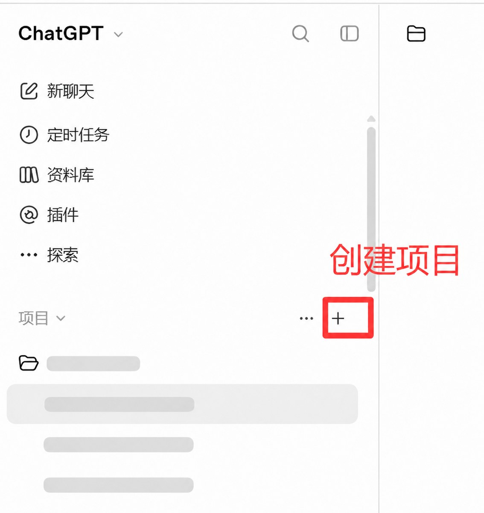
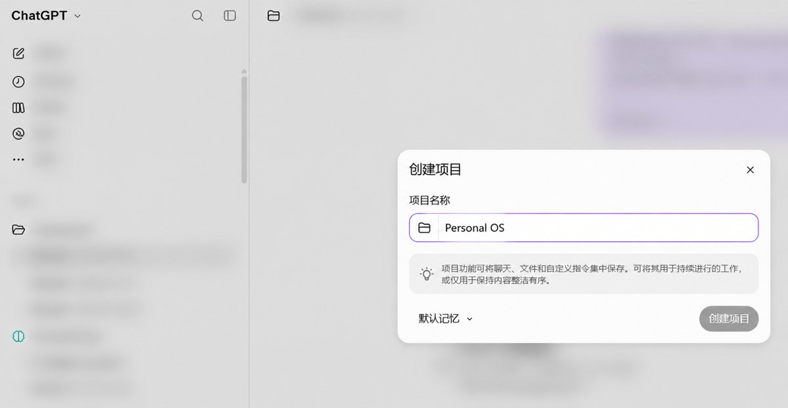
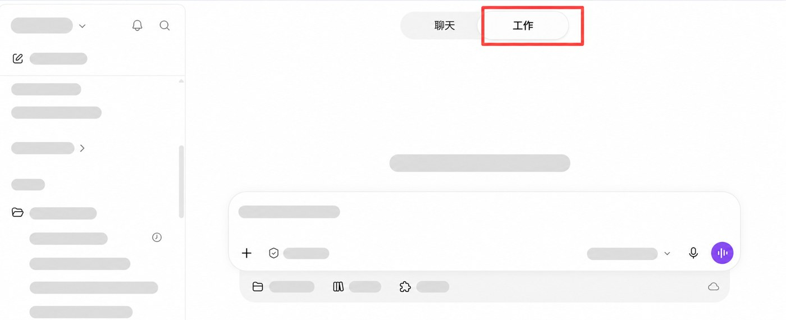
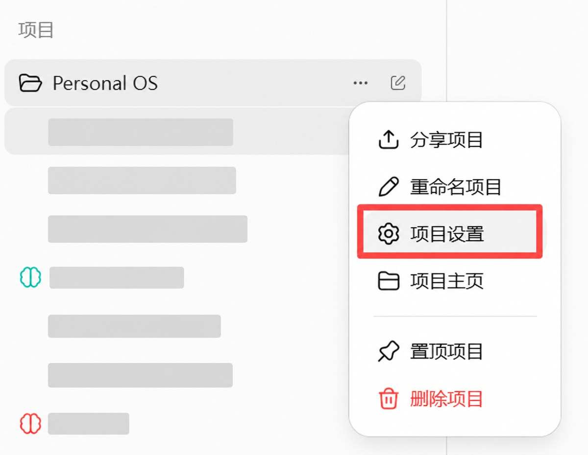
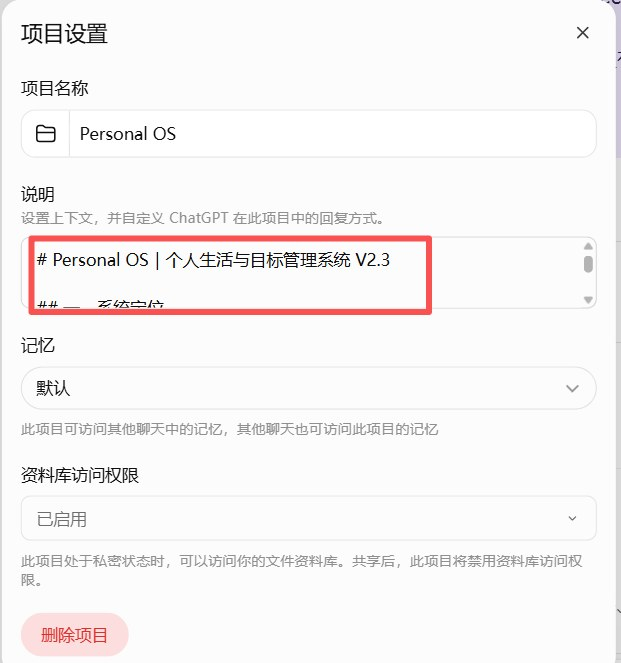

# Personal OS + Personal Brain：ChatGPT 同步到 Obsidian

> 不需要专门坐下来写日记。打开 ChatGPT，点一下语音转文字，想到什么就说什么。

很多人很难坚持写日记，不是因为没有内容，而是传统写日记需要专门腾出时间：回忆一天、组织语言、排版和分类。忙起来，最先被放弃的往往就是记录。

这套流程把写日记变成随手聊天：

1. 在手机或电脑上打开 ChatGPT，用语音转文字直接说，或者随手打字；
2. 经历、情绪、工作、人际关系和突然冒出的想法，想到什么就发什么，不需要整理格式；
3. 当天记录结束后，只发送一句“收工”；
4. ChatGPT 自动保留当天原始记录，并整理成结构清楚、可以直接阅读的当天日记。

真正降低门槛的地方，不是让 AI 替你编日记，而是把“专门写一篇日记”变成“随时说几句话”。你负责真实记录，AI 负责整理、排版和复盘。

在 AI 时代，长期、真实、可追溯的个人数据，会逐渐成为理解自己的重要资产。这套流程继续把每天的 RAW 和 DAILY 经过 Google Drive、PAM 正式准入自动同步到 Obsidian，让零散聊天沉淀成可以搜索、复盘、修订并供 AI 长期分析的个人资产。

生活记录放进 `Personal OS`；知识探索、想法和决策放进 `Personal Brain`。两个项目都在当天结束时使用“收工”。

之后按已经跑通的链路处理：

```text
Personal OS 项目聊天
→ Google Drive：PAM-OS-RAW / PAM-OS-DAILY
→ Windows 任务 PersonalAI-PAMDriveSync
→ PAM 正式准入
→ Obsidian：Personal-OS/Raw 与 Personal-OS/Daily
→ 04-Life/Daily 中的 PAM-DAILY 区块

Personal Brain 项目聊天
→ Google Drive：PAM-BRAIN-RAW / PAM-BRAIN-BRAIN
→ Windows 任务 PersonalAI-PAMDriveSync
→ PAM 正式准入
→ Obsidian：Personal-Brain/Raw 与 Personal-Brain/BRAIN
```

两个项目的 RAW 都只保存用户原始输入。Personal OS 的 DAILY 保存生活记录、经历与思考、认知观察和行动建议；Personal Brain 的 BRAIN 保存 Resource、Insight、Knowledge、Idea、Decision、待确认和后续探索。系统负责查重、修订、冲突保护、正式准入、路由和写后回读。

## 安装前先准备两个项目

用户需要先在 ChatGPT 中创建两个独立项目。创建流程：

1. 打开 ChatGPT，在左侧边栏找到“项目”。
2. 点击“项目”右侧的 `+`；如果界面显示“新建项目”，点击“新建项目”。



3. 输入项目名称 `Personal OS`，然后点击“创建项目”。记忆设置保持默认即可。



4. 再次点击 `+`，创建第二个项目 `Personal Brain`。
5. 确认左侧边栏能够分别看到这两个项目，不要把两套规则放在同一个项目里。

两个项目的用途：

1. `Personal OS`：记录真实生活和日记，生成 RAW/DAILY；
2. `Personal Brain`：记录知识探索、想法和决策，生成 RAW/BRAIN。

创建空项目即可。项目建好后，再按下面的安装方式配置规则。

## 打开新窗口，切换到工作模式

1. 使用 ChatGPT 桌面版打开一个新窗口或新聊天。
2. 在页面顶部从“聊天”切换到“工作”。
3. 如果系统询问运行位置或电脑访问权限，选择能够访问这台 Windows 电脑、本地文件和应用的本地工作方式。
4. 把下方安装提示词和本仓库 GitHub 链接一起发送。



只选择“工作”不代表一定获得了本地电脑权限。网页端或云端 Work 可以读取公开 GitHub，但不能直接在用户电脑上安装 Obsidian、创建 Vault 或配置 Windows 计划任务。完成本地安装需要 ChatGPT 桌面端实际开放本地文件或电脑操作能力。

## 能不能只发链接就自动填写项目规则

分两种情况：

- **支持自动填写：** 如果当前 ChatGPT Work、Codex 或桌面环境能够读取项目清单，并且具备修改项目设置或操作浏览器的能力，用户提供本仓库链接和安装提示词后，AI 可以取得两个真实 project ID，把完整规则写入对应项目，再打开项目设置回读核验。过程中仍可能需要用户确认登录、授权或界面操作权限。
- **不能自动填写：** 普通 ChatGPT 网页聊天通常不能仅凭一个 GitHub 链接修改自己或其他项目的设置。这种情况下，AI 应明确说明限制，并让用户分别把 [Personal OS V2.3](skills/personal-os-diary-sync/assets/personal-os-project-instructions.md) 和 [Personal Brain V2.0](skills/personal-os-diary-sync/assets/personal-brain-project-instructions.md) 中代码块内的完整内容粘贴到对应项目的“项目设置 → 说明”中。这是两次粘贴，不需要用户转抄运行日志。

无论使用哪种方式，都必须在写入后重新打开项目设置核对，不能把“已经读取 GitHub”当成“项目规则已经安装”。

### 无法自动填写时，手动配置项目规则

1. 在左侧边栏找到 `Personal OS`，点击项目名称右侧的 `…`，选择“项目设置”。



2. 在“说明”输入框中，粘贴 [Personal OS V2.3 完整项目说明](skills/personal-os-diary-sync/assets/personal-os-project-instructions.md) 代码块内的全部内容，然后保存。



3. 对 `Personal Brain` 重复相同步骤，粘贴 [Personal Brain V2.0 完整项目说明](skills/personal-os-diary-sync/assets/personal-brain-project-instructions.md)。
4. 重新打开两个项目的“项目设置”，确认说明开头分别为 `# Personal OS｜个人生活与目标管理系统 V2.3` 和 `# Personal Brain｜个人知识与认知管理系统 V2.0`。

## 最简单的安装方式

把本仓库的 GitHub 链接发给 ChatGPT/Codex，然后只发送这一句话：

```text
请按这个仓库的安装说明安装并配置 Personal OS 与 Personal Brain。先检查我是否已创建这两个 ChatGPT 项目；缺少时引导我创建，不能互换或代建错误项目。把仓库中的 Personal OS V2.3 和 Personal Brain V2.0 完整项目说明分别写入对应项目，并读取两个真实 project ID。检查这台 Windows 电脑是否已安装 Obsidian：如果没有，我授权你从 Obsidian 官方来源下载安装，并在执行前告诉我安装来源和默认 Vault 路径；如果我没有提出异议，继续创建 Vault 及仓库规定的 Personal OS、Personal Brain 和日记目录。能自动读取的配置直接读取，只有账号授权、Google Drive 连接、Vault 路径冲突、已有个人数据可能被覆盖或重要系统修改无法确认时再问我。完成后按仓库验收清单实测两个项目，不要把软件已安装、规则已配置或文件夹已创建当成同步已经跑通。
```

支持仓库插件安装的 ChatGPT/Codex 会读取根目录 `plugin.json`，安装后调用 onboarding Skill。Codex 也可以使用内置 `skill-installer` 从本仓库的 `skills/personal-os-diary-sync` 安装。Skill 能自动完成到哪一步，取决于当前环境实际开放的项目、Google Drive 和本地文件权限。

安装和本机写入仍需要用户确认账号登录、Google Drive 授权和本地文件权限。普通 ChatGPT 网页聊天不能绕过这些授权直接修改 Windows 上的 Obsidian；需要在支持本地文件操作的 Codex 或 ChatGPT 桌面环境中完成本地部分。

## 没有安装 Obsidian 能否跑通

同步器的底层产物是 Markdown 文件，因此没有 Obsidian 应用时，技术上仍可以把文件写入普通文件夹；但这只能算“Markdown 已生成”，不能算“Obsidian 已安装、Vault 已创建并完成路由”。

完整跑通至少需要：

1. Obsidian 已从官方来源安装并能够启动；
2. 已创建或明确选择一个 Vault；
3. Vault 中存在下面这些目录：

```text
Personal-OS/Raw
Personal-OS/Daily
Personal-OS/Weekly
Personal-Brain/Raw
Personal-Brain/BRAIN
Personal-Brain/Weekly
04-Life/Daily
```

4. `PersonalAI-PAMDriveSync` 已把一组真实测试文档正式准入并路由；
5. Obsidian 中能够打开对应文件，并且本地回读内容正确；
6. 重复运行不会重复创建或覆盖人工内容。

安装器会先检查现有 Obsidian 和 Vault。已有 Vault 时不会另建平行知识库，也不会在未确认的情况下覆盖已有个人目录；缺少 Obsidian 时，按 [Obsidian 安装与 Vault 初始化](skills/personal-os-diary-sync/references/obsidian-setup.md) 执行。仓库内置的 [Windows 初始化脚本](skills/personal-os-diary-sync/scripts/bootstrap_obsidian.ps1) 会在获得授权后核验官方 WinGet 包、安装 Obsidian、创建目录、启动应用并返回 JSON 结果。

详细安装边界见 [INSTALL.md](INSTALL.md)。

## 安装后会自动做什么

在相关权限和工具可用时，onboarding Skill 会尽量自行完成：

1. 先确认用户已经创建 `Personal OS` 和 `Personal Brain` 两个独立项目，再分别取得真实 project ID；不会把示例 ID 固化到代码或互换两个项目。
2. 把完整的 Personal OS V2.3 和 Personal Brain V2.0 项目说明分别写入并回读核验；无法修改项目设置时，退回到两次人工粘贴并明确说明。
3. 检查 Google Drive 连接、Obsidian Vault、Python、rclone、现有 PAM 文件、Windows 计划任务和日志。
4. Obsidian 缺失时，根据用户在安装提示词中的授权从官方来源安装；创建或选择 Vault，并建立正式目录后回读。
5. 保留已经通过验收的实现，不重复创建同名任务或覆盖现有配置。
6. 配置或修订两个项目各自的 Google Drive 归档规则。
7. 配置本地正式任务 `PersonalAI-PAMDriveSync`：每天 02:00、登录后 1 分钟补跑、禁止并发、失败每 5 分钟重试最多 3 次。
8. 先在隔离测试目录验证，再申请接入正式 Vault。
9. 实测两个项目的首次同步、重复运行、修订、`incomplete`、重复标题、错误项目/类型和人工编辑冲突。
10. 分别报告 Obsidian 安装、Vault 初始化、Google Drive、PAM 正式准入、Obsidian 路由、本地回读和无人值守实跑状态。

## 日常怎么用

不需要填写固定模板。生活记录发到 Personal OS，例如：

```text
今天终于把拖了很久的方案交了。真正卡住我的不是不会做，而是担心交出去被否定。
```

当天说完后发送：

```text
收工
```

只有明确的“收工”才触发正式日归档。“本周收工”“本月收工”、提醒消息和普通聊天都不触发这条链路。

知识、观点、资料、创意和决策讨论发到 Personal Brain，同样在当天结束时发送“收工”。两个项目不会自动把内容互相搬运。

## 当前规则

- Personal OS 云端只创建或原位修订 `PAM-OS-RAW-YYYY-MM-DD` 与 `PAM-OS-DAILY-YYYY-MM-DD`。
- Personal Brain 云端只创建或原位修订 `PAM-BRAIN-RAW-YYYY-MM-DD` 与 `PAM-BRAIN-BRAIN-YYYY-MM-DD`。
- 云端自动化不直接写 Obsidian；本地 `PersonalAI-PAMDriveSync` 负责正式准入与路由。
- RAW 只保留用户原话，不混入 AI 回复，不改写错别字和口误。
- DAILY/BRAIN 使用对应项目“收工”后同轮次最终整理结果，不补造缺失记录。
- 正文、分页、同日其他窗口或附件无法完整读取时，使用 `content_status: incomplete`。
- 同标题 0 份创建；1 份核验并按需修订；2 份及以上停止并报告冲突。
- 内容相同跳过；新增消息、附件变为可读或明确更正时，在原文档推进 `revision`。
- Personal OS 不生成 BRAIN；Personal Brain 不生成 DAILY。普通日归档不生成 WEEKLY 或 MONTHLY 云端文档。
- DAILY 只写入人工日记的 `PAM-DAILY-START/END` 区块；区块外内容不动。
- 一次运行即使退出码为 0，只要存在正式校验 reject，也必须报告为部分成功。

完整的 ChatGPT 项目提示词见 [Personal OS V2.3](skills/personal-os-diary-sync/assets/personal-os-project-instructions.md) 与 [Personal Brain V2.0](skills/personal-os-diary-sync/assets/personal-brain-project-instructions.md)。这两份才是需要写入项目设置的完整规则。

[Personal OS 云端补漏归档规则](skills/personal-os-diary-sync/references/personal-os-rules.md) 与 [Personal Brain 云端补漏归档规则](skills/personal-os-diary-sync/references/personal-brain-rules.md) 只用于定时检查 Google Drive 缺漏，不是项目说明。

## 进阶玩法：让 AI 跟进近期目标

基础规则只负责自然记录和日记整理。如果近期有一个明确目标，希望 AI 在日常记录中持续关注，可以把目标加入 `Personal OS` 项目规则。不要改动 RAW/DAILY、YAML、Google Drive 或 Obsidian 协议，只新增一段清楚的目标说明。

例如，未来 30 天准备求职，可以在项目规则的「日常交互原则」后加入：

```text
### 当前重点目标

目标：未来30天完成简历优化，并且每周至少投递5个合适岗位。

记录：保留我实际提到的投递数量、反馈、阻碍和下一步。未提及表示未记录，不视为0，也不判断为未完成。

跟进：普通聊天不要频繁打断；在 DAILY 的「明日关注」中，最多提出1项与这个目标直接相关、可以执行并能判断是否完成的行动。
```

目标结束后删除或替换这段即可。也可以换成备考、作品发布、运动习惯等目标；AI 只能根据真实记录判断进度，不能把计划当作完成。

## 已跑通到什么程度

截至 2026-11-08，参考实现已真实运行：Google Docs 导出、SHA-256、正式准入、元数据路由、重复运行跳过、DAILY 日记嵌入、Windows 02:00/登录触发均有日志证据。最近一次 Personal OS 检查中，有效文档已路由并完成两份 DAILY 嵌入，同时仍有 3 份早期格式错误文档被拒绝；这也是本 Skill 坚持分层报告的原因。

Personal Brain V2.0 项目说明及 RAW/BRAIN 协议已从实际项目设置回读并纳入 Skill，但这次打包没有新建正式 Google Docs，也没有重新触发 Windows 任务。新用户安装后仍必须分别实跑两个项目，不能把模板已安装说成同步已经完成。

公开仓库不包含真实项目 ID、Google 文件 ID、用户名、Vault 路径、日记正文或生产日志。状态快照见[参考实现状态](skills/personal-os-diary-sync/references/reference-status.md)。

## 文件导航

| 文件 | 用途 |
|---|---|
| [INSTALL.md](INSTALL.md) | GitHub 链接安装方式和真实能力边界 |
| [SKILL.md](skills/personal-os-diary-sync/SKILL.md) | 安装、配置、维护和排障入口 |
| [Personal OS 项目说明](skills/personal-os-diary-sync/assets/personal-os-project-instructions.md) | 可直接加入 ChatGPT 项目说明 |
| [Personal Brain 项目说明](skills/personal-os-diary-sync/assets/personal-brain-project-instructions.md) | 可直接加入 ChatGPT 项目说明 |
| [Personal OS 云端补漏归档规则](skills/personal-os-diary-sync/references/personal-os-rules.md) | 定时检查 RAW/DAILY 是否遗漏，不是项目说明 |
| [Personal Brain 云端补漏归档规则](skills/personal-os-diary-sync/references/personal-brain-rules.md) | 定时检查 RAW/BRAIN 是否遗漏，不是项目说明 |
| [本地同步规则](skills/personal-os-diary-sync/references/local-sync.md) | PAM V2.3、本地任务和日记嵌入规则 |
| [Obsidian 安装与 Vault 初始化](skills/personal-os-diary-sync/references/obsidian-setup.md) | 缺少 Obsidian 时的官方安装、目录创建和核验 |
| [验收清单](skills/personal-os-diary-sync/references/acceptance.md) | 判断每一层是否真的完成 |
| [隐私规则](skills/personal-os-diary-sync/references/privacy.md) | GitHub 发布和日志脱敏 |

## 隐私检查

发布前运行：

```powershell
python skills/personal-os-diary-sync/scripts/privacy_scan.py .
```

本仓库目前未预设 LICENSE；正式公开前应由仓库所有者选择许可证。

仓库结构采用 OpenAI 官方的 plugin + skills 结构。参见 [Package your plugin](https://developers.openai.com/plugins/build/plugins) 和 [Skills](https://developers.openai.com/plugins/concepts/skills)。


